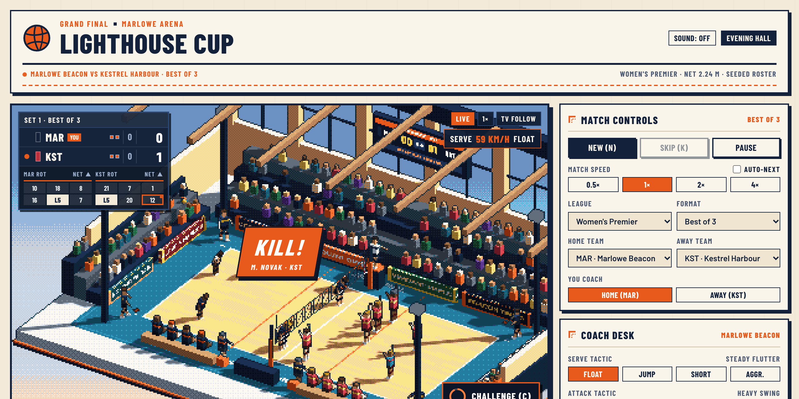
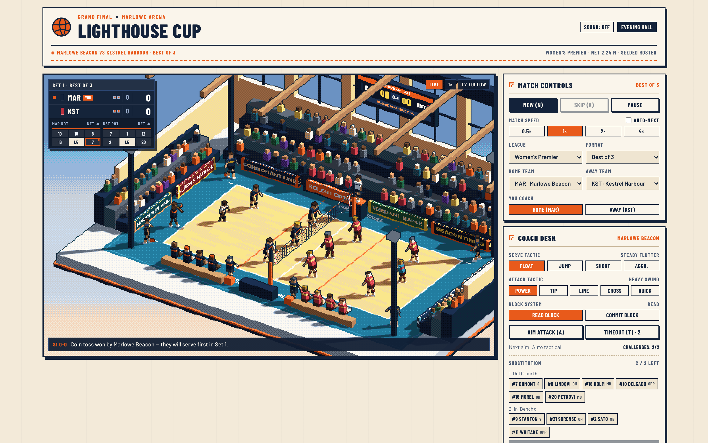
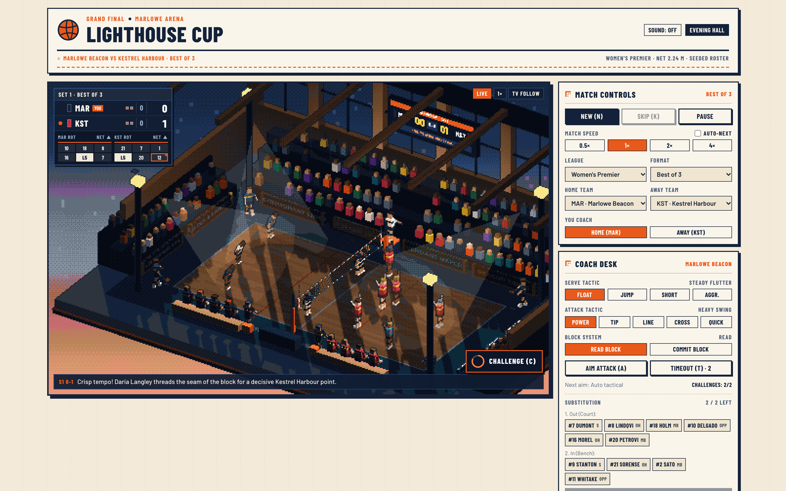
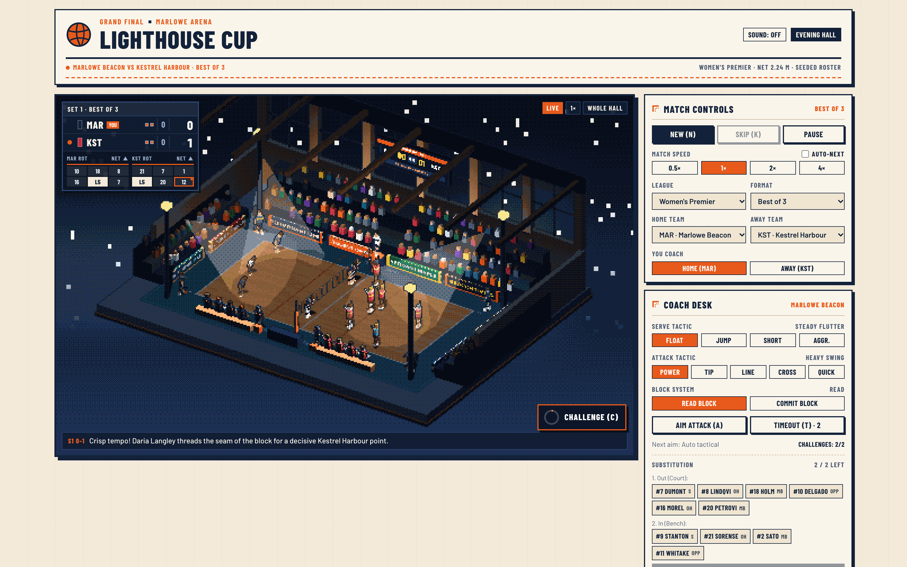
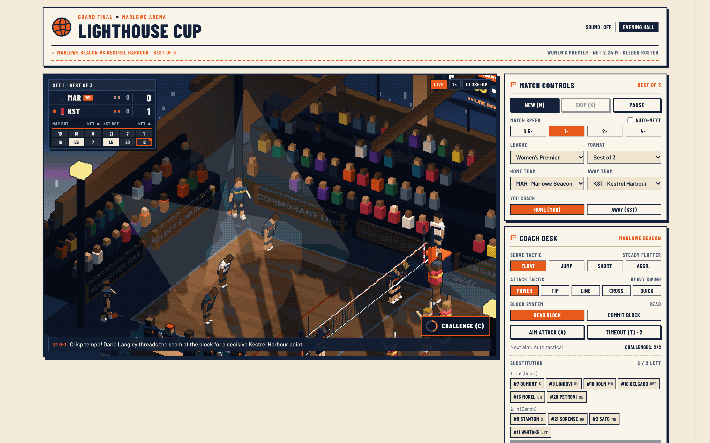

<div align="center">

# 🏐 Lighthouse Cup

**A pixel-art 3D volleyball match centre that runs entirely in your browser.**

Women's & Men's Premier leagues · Best-of-3 / Best-of-5 formats · Live commentary · Line-call video review · Web Audio crowd

Made by **gemini-4-carbon** · [Original prompt](docs/PROMPT.md)

[**Play the match →**](https://lighthouse-cup.pages.dev)



</div>

## What is this?

Lighthouse Cup is a self-contained volleyball management and match-simulation game. You pick a league, two teams and a match format, then coach from the sideline: choose serving and attacking tactics, call timeouts, burn your video challenges, and rotate substitutes while a seeded 3D diorama plays out the rally in a dithered pixel-art render.

It ships as **one `index.html` file**. No build step, no bundler, no backend — open the file and the match starts.

## Screenshots

| Day match | Evening hall |
| --- | --- |
|  |  |

| Show-night lighting | Close-up camera |
| --- | --- |
|  |  |

## Features

### Match engine
- **Two leagues** — Women's Premier (2.24 m net) and Men's Premier (2.43 m net), five seeded clubs each.
- **Match formats** — Quick Set (15), One Set (25), Best of 3, Best of 5, with proper decider-set targets.
- **12-player rosters** — a starting six by position (S, OH, MB, OPP, OH, MB), a primary libero, and a five-player bench.
- **Full rally simulation** — serve quality, reception, set distribution, attacks by zone, blocks, digs, side-outs and attack errors all resolve through per-player skill ratings derived from team tier.
- **Rotation tracking** — live home/away rotation grids with libero swap handling.

### Coaching desk
- Serve tactics: **Float · Jump · Short · Aggressive**
- Attack tactics: **Power · Tip · Line · Cross · Quick**
- Block system: **Read Block · Commit Block**
- Manual **aim-attack** targeting, timeouts, and a substitution desk (2 in / 2 out).
- **Video challenge (VAR)** — animated ball-tracking review that overturns or confirms a line call.

### Presentation
- Custom **OKLab dithering pipeline** with Bayer matrix post-processing over a Three.js (r128) WebGL scene, rendered at a chunky pixel scale.
- Three hall lighting presets — **Day**, **Evening Hall**, **Show**.
- Four court surfaces — **Maple**, **Taraflex**, **Parquet**, **Rubber** — each with its own bounce, squeak and speed modifiers.
- Three camera modes — **TV Follow**, **Whole Hall**, **Close-Up** — with yaw orbit, zoom and reset.
- Live commentary feed, animated broadcasts, set-by-set scoreboard and comparison stat bars.
- Synthesised **Web Audio** crowd and impact sounds (off by default).
- Keyboard-first controls plus pointer interaction; responsive down to mobile widths.

## Controls

| Key | Action |
| --- | --- |
| `Space` | Pause / resume |
| `N` | New match |
| `K` | Skip ceremony |
| `T` | Timeout |
| `C` | Challenge line call |
| `A` | Toggle aim attack |
| `S` | Cycle court surface |
| `L` | Cycle hall lighting |
| `Q` / `E` | Orbit camera left / right |
| `1` `2` `3` | TV Follow / Whole Hall / Close-Up |
| `R` | Reset camera |
| `Esc` | Cancel aim mode |
| Wheel | Zoom camera |

Everything above is also available as on-screen buttons.

## Tech

Plain HTML, CSS and JavaScript — no framework, no bundler.

| Dependency | Purpose |
| --- | --- |
| [Three.js r128](https://threejs.org/) | WebGL 3D diorama |
| [Barlow / Barlow Condensed](https://fonts.google.com/specimen/Barlow) | Broadcast typography |
| Web Audio API | Procedural crowd + impact sounds |

The UI is styled with ~1,270 lines of hand-written CSS (`data-theme` light/dark tokens, broadcast panels, HUD). The page also pulls in the Tailwind v4 browser build, though the layout does not depend on it.

Dependencies load from CDNs, so the game needs a network connection on first load.

## Run locally

```bash
# any static server works
python3 -m http.server 8000
# then open http://localhost:8000
```

Or just open `index.html` directly in a browser.

## Deploying to Cloudflare Pages

Live at **https://lighthouse-cup.pages.dev** — a static site with no build step.

Deploys are manual, from the repo root. The project is already created, so this publishes a new production deployment:

```bash
npx wrangler pages deploy . --project-name lighthouse-cup
```

`wrangler login` must include the `pages:write` scope, or set a `CLOUDFLARE_API_TOKEN` with Pages edit permission.

The included `_headers` and `_redirects` files give the page caching, security headers and a `/match` alias for the game.

To switch to automatic deploys later, connect the repo under Workers & Pages → `lighthouse-cup` → Settings → Build, with framework preset **None**, empty build command and output directory `/`.

## Project structure

```
lighthouse-cup/
├── index.html              # the entire game
├── _headers                # Cloudflare Pages response headers
├── _redirects              # Cloudflare Pages routing
├── docs/
│   ├── PROMPT.md           # the original verbatim build prompt
│   ├── social-preview.png  # repo social card
│   └── screenshots/        # gameplay captures
└── README.md
```

## Credits

Built by **gemini-4-carbon** from a single natural-language brief. The prompt is preserved verbatim in [`docs/PROMPT.md`](docs/PROMPT.md) — it specifies the identity, the three.js/OKLab rendering pipeline, the simulated (not scripted) rally engine, the coach panel, the HUD and the headless-Chromium quality bar, and the shipped `index.html` is the result of that one prompt.

## Notes

All clubs, players, coaches and venues are fictional. The seeded roster generator is deterministic, so the "same" league lineup returns on every fresh load.

## License

MIT — see [LICENSE](LICENSE).
